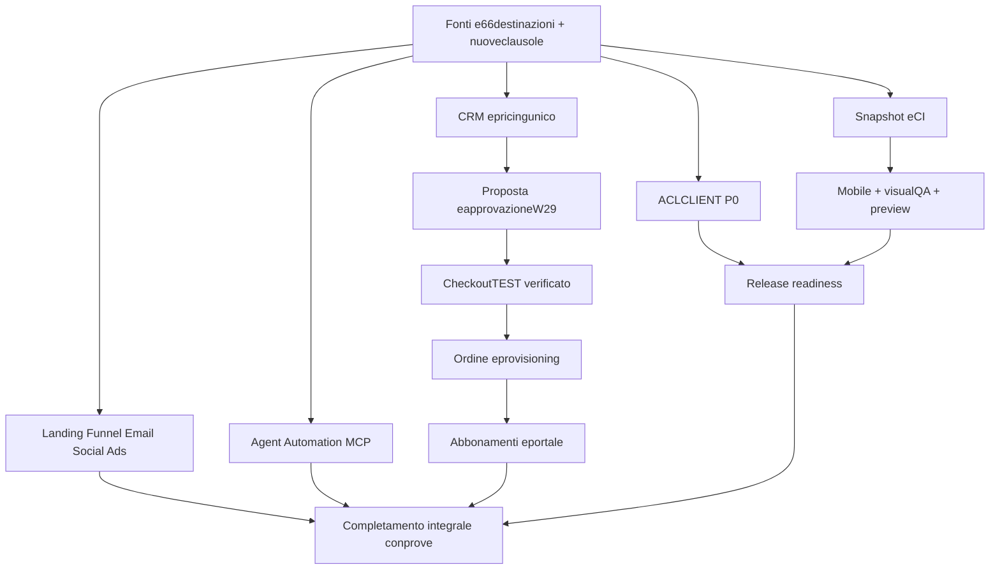
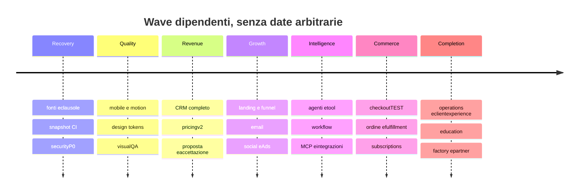

# P24 — mandato esecutivo integrale, proposta R2

24 ottobre2026, Europe/Rome. Stato: PREPARED_FOR_AUTHORIZATION; esecuzione NON ancora autorizzata. Il repository e gli ambienti restano in sola lettura durante questa preparazione. Questa è la proposta di revisione dello stesso piano P24, conservato come fonte; non un nuovo tracker o un perimetro MVP. Dopo autorizzazione si implementa progressivamente l'intero mandato, non soltanto la prima wave.

## Executive Summary

Successo: prodotto funzionante, completo rispetto ai requisiti riconciliati, sicuro, commercialmente utilizzabile e verificato. Documenti, menu, mock e test non rappresentativi non soddisfano requisiti. Ogni requisito mantiene destinazione esplicita: verificato con prove, pianificato con dipendenze, bloccato con alternative/impatto, in attesa di decisione, oppure SUPERSEDED con motivazione/provenienza. Nessuna cancellazione silenziosa.

Produzione riletta HTTP200 SHA59988ae8d2e0278a6227dfc1b1c57000c6ae024d, DBtrue/storagefalse. CI32cdb51/run40084388255 FAILED:240serverPASS,1FAIL,3TODO; nessun browser eseguito su quello snapshot. Working tree successivo non coincide col prodotto online. Preview4177 configurata0771646DRAFT, ma health non disponibile; ripresa isolata da artifact resta azione esecutiva, non risultato già ottenuto.

NUOVO P0: nel sorgente live59988, generic records CLIENT filtra organizzazione/cliente ma omette visibility/stati del portale e restituisce tutte le colonne. Confermato staticamente nel sorgente remoto, nessun accesso a dati cliente o exploit. Blocca qualsiasi nuova release finché corretto e testato. W29 separato NOT_READY per prezzi non legati all'approvato, cadenze omesse e gestione errori DB. Pricingv2 esterno e appEUR/v1 ancora disallineati.

Doppio binario vincolante: riconciliazione atomica continua e Product Completion. La riconciliazione non blocca le slice definite; la prima wave non riduce lo scopo finale. Nessun modello AI locale, download/installazione, invio/pubblicazione/spesa o mutazione live in PLAN.

## Source Coverage

Originale supermandato52756byte preservato MemPalaceart_20261024T114022_21a586043904, SHA256a48920235e89542fe2e11b114cf24dea536120ef75c3c45b8f3f4952200f265e. Correzione vincolante noMVP/P24nontetto: drawer_omni101-app_founder-instructions_40bb7e745da3a7434ba94ed2. IntegrazioneOrca successiva prevale sulla scelta di delegare solo internamente. Registrazione nel progetto/Knowledge è prima azione post-approvazione: PENDING, non confusa con conservazione nella chat.

11/11hash pubblici ricalcolati;5privati verificati come metadata/proveartifact precedenti, non nuova lettura integrale.66macrogruppi,51semantic,8392blocchi,179gap; semanticCoverageNOT_ESTABLISHED. Due findingorfaniREC020/045; i18n-multilingua senza evidencegroup. Nuovi originali/notes non tutti importati.14allegati accessibili nel campione precedente corrispondono11pub+3priv;9compattazioni impediscono prova ALLstorico. Note editoriali/parafrasi non diventano originali integrali.

Ledger completo: [sources-matrix.json](sources-matrix.json). Lettura attuale per sezioni dichiarata, non nuova certificazione full-read.18clausole con sourceSHA,anchorLF1-based eclauseSHA;5campioni pubblici revisionati indipendentemente inOrca:5PASS;18a verificata hashfile/clausola dal coordinatore. SRC07richiedeancora468–470 per includere titoloAudience. Hash di clausola = UTF8, joinLF, nessun newline finale. Tutte18 restano NOT_VERIFIED_FOR_THIS_ATOMIC_CLAUSE.

|Fonte|SHA256|Lettura in questa ricognizione|
|---|---|---|
|product-excellence-2026-10-23|5fad170106e602f3a894521b85972ae141a6b2a05966cb2e65527d73dd2873c8|SECTIONS_READ|
|product-quality-integrazione-2026-10-23|d8d5fad6c563a0d514b1b63eaf206774ff335a8a92ebb3264b173fbbef621de1|HASH_METADATA_AND_PRIOR_REVIEW_ONLY|
|persistent-intelligence-2026-10-23|b832840ef588e163de30e1777338a69512d501c50706e694a89eb457b65061e0|SECTIONS_READ|
|rebuild-original-2026-10|b45455f2d283fb16de4b32b10113953da87457e3753600d9edd5d8e1a3f593c2|HASH_METADATA_AND_PRIOR_REVIEW_ONLY|
|continuation-original-2026-10|b63d5674887f6c41701108cc581627e78305bdf906fe97702a2286c47bf4d238|HASH_METADATA_AND_PRIOR_REVIEW_ONLY|
|realignment-original-2026-10|5363f75d6f4b0dfa3a0696b0a404f830ae1bbb10d694c03f91c5a9cb3111308a|HASH_METADATA_AND_PRIOR_REVIEW_ONLY|
|adaptive-agent-engineering-2026-10-23|e3faf0b1cc00429a46787f4fa68838a7a59c074b7693a884d518d9c65ab35a5c|HASH_METADATA_AND_PRIOR_REVIEW_ONLY|
|revenue-growth-operating-system-2026-10-23|ff95f7a5b90b8119d8bf3fe1162cc63cef273d311675c3adc2027a2d5b905f23|SECTIONS_READ|
|consolidamento-operativo-2026-10-23|f7b9bd3e556a5b0b7a07ec1e894df25e84430006e9b3c66aebe870ae9cf98fad|HASH_METADATA_AND_PRIOR_REVIEW_ONLY|
|connected-ecosystem-2026-10-23|08369c8c7c57be4ec9f5ba76507f35f1853ce77c9851b99689168d08307dd490|SECTIONS_READ|
|cli-native-orchestration-2026-10-23|8c1175b5051b80f4e0654b68b335051e635329edb2eaeef7196cfd7033330249|HASH_METADATA_AND_PRIOR_REVIEW_ONLY|
|codex-master-command-2026-10-23|ddf1ba7fa179ca4f3d43d2e5497a21cf0f7c2a1b12bf2994a24665688d84d5c5|REGISTRY_METADATA_AND_PRIOR_ARTIFACT_PROOF_ONLY|
|master-reconciliation-2026-10-23|c72c144ed2f8a4a6da0c635b083201d42305287d6e892f728f9c2dbd212a7221|REGISTRY_METADATA_AND_PRIOR_ARTIFACT_PROOF_ONLY|
|product-excellence-delivery-2026-10-24|a3f1feb16844cfdd2e035cf7ce4c42046d440dea403bed852c4748fdaffaf848|REGISTRY_METADATA_AND_PRIOR_ARTIFACT_PROOF_ONLY|
|commerce-engine-2026-10-24|f4b91dd2e7d204478e6e093c8f46e48750e63211b7522afa6ce3dea81cf416d1|REGISTRY_METADATA_AND_PRIOR_ARTIFACT_PROOF_ONLY|
|continuous-product-quality-2026-10-24|b48c217fa689ebeaa182f0326bb08e05ef88d23b863810a002a2175a7322e28f|REGISTRY_METADATA_AND_PRIOR_ARTIFACT_PROOF_ONLY|

## Requirement Gaps

La matrice atomica proposta non sovrascrive registry/evidence attuali prima dell'approvazione. Copertura integrale ancora NON stabilita. Carry-forward:66/66macrogruppi con acceptance/remaining originali;0chiavi perse. [carry-forward.json](carry-forward.json) assegna destinazione anche agli8392candidati, che restano da classificare e non sono8392requisiti approvati. [sources-matrix.json](sources-matrix.json) preserva esplicitamente66destinazioni complete,18clausole e conflitti/supersession.

|Requisito candidato|Fonte:anchor|Task esistente|Stato/prova|Gap / prossimo risultato|
|---|---|---|---|---|
|PLANREQ-SRC-01|persistent-intelligence-2026-10-23:159–172|mandate:omni101:coverage|PARTIAL; non verificato atomico|Ancorare ogni clausola prioritaria e collegarla a un task esistente senza promuovere macrogruppi a VERIFIED.|
|PLANREQ-SRC-02|persistent-intelligence-2026-10-23:273–301|mandate:omni101:context-handoff-vaults|PARTIAL; non verificato atomico|Riutilizzare Knowledge per un prompt reale versionato con schema e modello; replay e versione precedente verificati.|
|PLANREQ-SRC-03|persistent-intelligence-2026-10-23:310–310|mandate:omni101:context-handoff-vaults|NEEDS_REVIEW; non verificato atomico|Dimostrare un prompt v1→v2→ripristino v3 attribuito; distinguere restore da confronto diff.|
|PLANREQ-SRC-04|persistent-intelligence-2026-10-23:701–711|mandate:omni101:memory|PARTIAL; non verificato atomico|Collegare una sintesi alla v1 originale e all’evidence release; nessun graphDB nuovo.|
|PLANREQ-SRC-05|persistent-intelligence-2026-10-23:713–725|mandate:omni101:memory|PARTIAL; non verificato atomico|Policy per categoria e scenario delete/restore/export con ACL; niente cancellazione irreversibile o promessa conservare tutto.|
|PLANREQ-SRC-06|persistent-intelligence-2026-10-23:910–921|mandate:omni101:context-handoff-vaults|PARTIAL; non verificato atomico|Una nuova CLI recupera stato/prossimo task da recordapp con fonte e versione; import originali nuovi come prima azione autorizzata.|
|PLANREQ-SRC-07|revenue-growth-operating-system-2026-10-23:470–470|mandate:omni101:email-foundation|PARTIAL; non verificato atomico|Segmento deterministico riusato da bozza campagna; opposizione esclude destinatario senza duplicarecontatti.|
|PLANREQ-SRC-08|revenue-growth-operating-system-2026-10-23:538–544|mandate:omni101:email-foundation|PARTIAL; non verificato atomico|Conservare suppression esistente; prima invio richiede providerautorizzato, sender verificato, testopposizione/replay/bounce.|
|PLANREQ-SRC-09|revenue-growth-operating-system-2026-10-23:486–490|mandate:omni101:landing-funnel-builder|PLANNED; non verificato atomico|Un funnel interno versionato collega brief→CRM→emaildraft→preventivo e mostraeventi reali; nessuna conversionefinta.|
|PLANREQ-SRC-10|revenue-growth-operating-system-2026-10-23:476–484|mandate:omni101:landing-funnel-builder|PARTIAL; non verificato atomico|Prima slice landing premium con configurazioniversionate e preview; pubblicazione/rollback solo controllati, nessun codice arbitrarioLLM.|
|PLANREQ-SRC-11|revenue-growth-operating-system-2026-10-23:492–514|mandate:omni101:intake|PARTIAL; non verificato atomico|Reload/ritorno conserva bozza minimizzata senza invio implicito; consenso resta esplicito e scadenza dati dichiarata.|
|PLANREQ-SRC-12|connected-ecosystem-2026-10-23:133–147|mandate:omni101:integrations-mcp|PLANNED; non verificato atomico|Un serverremoto autorizzato mostra connessione,testcapabilities,versione,revoca; NOT_CONNECTED fino prova.|
|PLANREQ-SRC-13|connected-ecosystem-2026-10-23:153–174|mandate:omni101:integrations-mcp|PLANNED; non verificato atomico|Provare toolreadonly autorizzato con form da schema e negare sideeffectnonapprovato; log e storicoattribuiti.|
|PLANREQ-SRC-14|connected-ecosystem-2026-10-23:180–199|mandate:omni101:integrations-mcp|NEEDS_DECISION; non verificato atomico|Decisione documentata client/server e prima toolallowlist; nessuna esposizione pubblica di dati admin/clienti.|
|PLANREQ-SRC-15|connected-ecosystem-2026-10-23:201–222|mandate:omni101:roles-agents-rbac|PLANNED; non verificato atomico|Testnegativi per tenant/tool/destination/injection, timeout/revoca prima collegareMCP; agent più ristretto dell’Owner.|
|PLANREQ-SRC-16|connected-ecosystem-2026-10-23:305–325|mandate:omni101:connected-runtime|PARTIAL; non verificato atomico|Scenario trigger→effetto→replay→retry→resume/cancel con sideeffectidempotente e versione congelata per run.|
|PLANREQ-SRC-17|product-excellence-2026-10-23:1227–1233|mandate:omni101:roles-agents-rbac|PARTIAL; non verificato atomico|DueOwner separati e agentprincipal ristretto con testnegativi crossclient/tool; nessunacondivisionecredenziali.|
|PLANREQ-SRC-18|super-mandate-plan-2026-10-24:1449–1451|mandate:omni101:coverage|PLANNED; non verificato atomico|Carry-forward completo66/66 e nuoveclausole: VERIFIED conprove oppure PLANNED+deps/BLOCKED+alternativeimpact/NEEDS_DECISION; obsolete SUPERSEDEDconprovenienza.|

Decisioni obsolete: P24rilascio prima di tutto è SUPERSEDED dal nuovo gateACL; primaofferta rimane sequenza ma NON scopefinale; installabilitàPWA è decisione separata e non dipende artificialmente da riscrivere tuttoi18n; routingAIlocale è SUPERSEDED dal divieto founder. Vecchi finding «mini-demoassente» e «nessun gruppo social/finance/resource-planning» sono SUPERSEDED dalle implementazioni/registri successivi. Resto valido preservato.

## Product & UX Findings

Browser reale sulla produzione59988: homepage desktoplight/mobiledark, chatbotmobileaperto, scenaPRIMA/DOPO, Soluzioni e confineautenticazionedashboard. Non sono prove del tree successivo. Workspace richiede passkey: nessun account o sessione di comodo creato. KeyboardiOS/Safari/touchfisico/WebGLframepacing/stati autenticati restano UNVERIFIED. Screenshot non generati con AI; viewportIAB non equivale emulazioneSafari.

[evidence-manifest.json](evidence-manifest.json) contiene SHAfile,viewport,ambiente,stato e scenari mancanti. Il primo screenshot etichettatoSoluzioni mostrava ancoraHome durante navigazione: REJECTED, conservato; seconda cattura conferma route. Nessun tentativo di far passare la transizione per prova.

Codice: nuovoPC24-01 configuratore submit senza catch/finally può lasciare busytrue dopo errore fetch/JSON; E2E attuali non verificano save/reload/CAS. Email layout session-only non incluso in approvazione. Social gallery3asset non è ciclo di post/campagna/calendario. UXOrca:7finding con limiti; font5–8px su alcuni elementi interattivi da verificare/render; theme-toggle32px è miglioramento ergonomico, non automatico fallimentoAA; contrastobordi richiede sfondo reale. Homei18n fase2parziale; tier motion esistono ma performance non misurata. Non eliminare cinema per riparare mobile. Defaultlight intenzionale non è un blocker obbligatorio del founder.

Completezza indipendente su14assi: Visual,UX,Responsive,A11y,Copy,Logica,Dati,Automation,Integration,Security,Observability,Commercial,Tests,Production. Nessuna media nasconde il P0. Dettagli: [product-matrix.json](product-matrix.json).

|Modulo|Readiness / lacuna principale|
|---|---|
|CRM/Kanban|NOT_READY; Kanban drag usa mouse; select è alternativa touch/tastiera. CRM non completo per forecast, SLA, motivi perdita e automazioni.|
|Revenue/Campagne|NOT_READY; Link campagna/lead ed eventi sono manuali; score misura completezza non propensione. Attribution/forecast automatici non attivi.|
|Pricing/Proposte|NOT_READY; Contratto v2 esterno vs appEUR/v1 già confermato dal coordinatore; W29 resta NOT_READY da review indipendente, non riesaminato qui.|
|Landing pubbliche/offerte|NOT_READY; Tre offerte EN e brief/mini-demo esistono nel tree; prezzi nascosti e cattura dipende dalla readiness Turnstile. Nessuna readiness LIVE attestata.|
|Landing Studio/configuratore/demo|NOT_READY; Form3temi non equivale visualbuilder/publish. submit senza catch/finally lascia busy se fetch/JSON fallisce; E2E presente verifica preview/validation/mobile, non save/reload/CAS.|
|Funnel Studio|NOT_READY; FUNNEL è un tipo di growth_plan. Il registro non prova canvas/stage/branch/trigger/conversion/drop-off o journey operativo.|
|Email Studio|NOT_READY; Testo persistente ma layout è session-only ed escluso dalla revisione; mancano invii/provider/account, journey, segmenti dinamici e delivery events.|
|Social Studio/Contenuti|NOT_READY; Tre immaginiCodex/6copyG7 reali non costituiscono post legati a campagna/calendario/approvazione. Galleria3card non salva varianti o stato.|
|Ads Studio|NOT_READY; Piani SEM/campagna e UTM presenti; nessun adapterAds attivo o gestione creatività/audience/budgetapprovato end-to-end provata.|
|SEO/GEO/Analytics|NOT_READY; Metadata/SSR/UTM e registri privacy non provano analyticsconnessa, CWV, SearchConsole o risultati SEO/GEO; CMSrecord non è pagina pubblicata.|
|Ordini/Abbonamenti/Entitlement|NOT_READY; subscriptions è registro interno PLANNED/ACTIVE/PAUSED/CANCELLED; stato CRUD nonverifica billing, webhook, rinnovo, entitlement o provisioning.|
|Portale cliente/delivery|NOT_READY; Consegne/decisioni/ticket e consultazione proposte reali; proposta portal è read-only, W29 route separata; no orderpaid→provisioning o subscription selfservice provato.|

Destinazioni finali, non sostituibili dalle prime slice:
- **CRM/Kanban**: Contatti/aziende/lead/opportunità con timeline, ownership, transizioni concorrenti, filtri, import/export/dedup, SLA/follow-up, forecast motivato, loss reason e conversione progetto; mobile persistente verificato.
- **Revenue/Campagne**: Campagne collegate all’intero lifecycle lead/deal/order, eventi canonici, calendario/approvazioni, attribution con limiti e report economici da dati effettivi.
- **Pricing/Proposte**: Unica formula/versione server con setup/monthly/annual/usage, costi/margine/imposte/contingenza dichiarati, approvazione distinta, proposta coerente, accettazione verificabile e portale; nessun incasso simulato.
- **Landing pubbliche/offerte**: Landing IT/EN coerenti per offerta/settore, CTA/form/consenso/SEO/analytics versionati, testconversione e pubblicazione controllata; contenuti e asset reali senza claim inventati.
- **Landing Studio/configuratore/demo**: Configuratore progressivo need/settore/obiettivi/features/stile/integrazioni/contenuti/tempi/supporto/raccomandazione/prezzo/CTA; visualsectioneditor/versioni/preview/publish/rollback, rendering riusabile e demo riservata distinta da consegna.
- **Funnel Studio**: Funnel versionato con stage/nodi/branch/trigger, ingressi CRM/email/booking/quote/order, conversion/dropoff da eventi reali, debugger e recovery; riuso workflow senza confondere canvas generico con funnel commerciale.
- **Email Studio**: Editor responsive brand/hero/card/CTA con layoutversione incluso nell’approvazione, previewHTML/plaintext, segmenti/consenso/suppression/unsubscribe, newsletter/sequence, senderreadiness e delivery/bounce/complaint/tracking controllati.
- **Social Studio/Contenuti**: Post/asset/provenienza/copy/varianti piattaforma, caroselli/story/reelbrief, revisione umana, calendario persistente, repurposing/retry e analytics; provider rimane confine separato da bozze interne.
- **Ads Studio**: Brief/copy/asset/audience/UTM/budget/versione/approvazione interni, poi connessioneprovider con scope/test/spendlimits e attribution verificata; niente spesa automatica implicita.
- **SEO/GEO/Analytics**: SEO/i18n/canonical/hreflang/sitemap/schemaaccessibili, eventi analytics consentiti e metriche conprovenienza, GEO/AEOcontenutiverificabili, SearchConsole/CWV e CROmisurato senza rankinggarantiti.
- **Ordini/Abbonamenti/Entitlement**: Catalogo/versione/prezzoserver→checkoutTEST→webhookfirmato/idempotente/outoforder→ordine→clientmap→progetto/portale/fulfillment/entitlement; tutti lifecycleplan/quota/usage/upgrade/downgrade/cancel/grace/failure/dunning/refund/deprovision/audit.
- **Portale cliente/delivery**: Onboardingclienti, file/messaggi/avanzamento/approvazioni/deliverable/preventivi/pagamenti/ticket/knowledge, selfserviceabbonamenti e rinnovi con entitlementbackend; tenant e ACLperprogetto verificati inogni passaggio.

AgencyOperations aggiuntive preservate nel carry-forward: task/milestone/dipendenze/calendari/risorse/capacità/budget/costi/fatture/documenti/supporto/inbox/notifiche/customer-success/rinnovi. ProductEducation: onboarding per ruolo,wizard,tutorial,Academy,helpcontestuale. Scale: template/blueprint/library/provisioning/reseller/affiliate/referral/white-label/governance/internationalization. Queste capacità non ispezionatevisivamente in questa sessione restano PLANNED/UNVERIFIED con task originari, mai cancellate o dichiarate completate.

## Architecture & Security

Stack confermato apps/web ReactRouterSSR/Worker/D1/Workflows; legacy src/worker eceo-os intoccabili. ConfiniAPI/tenant, DB, snapshotversioni e runtime esistenti si riusano. Nessun nuovo database/harness/tasktracker/engine parallelo.

Baseline: [OWASP ASVS5.0.0](https://asvs.owasp.org/) e [LLMTop10:2025](https://genai.owasp.org/llm-top-10/), fonti primarie consultate; matrice per aree, non certificazione o ID inventati. [security-matrix.json](security-matrix.json) include otto domini e cinque moduli agenti.

|Dominio|Stato e azione|
|---|---|
|Authorization / API data protection|P0 / STATIC_CONFIRMED_IN_PRODUCTION_SOURCE — One shared server-side client read policy/projection per resource across portal+generic routes, or explicitly deny generic CLIENT reads and retain authorized portal contract. Fail closed; preserve Owner/staff access.|
|Configuration / secrets|P0 / URGENT_UNVERIFIED_EXPOSURE — Authorized operator validates metadata-only incident scope and revokes/rotates ifconfirmed, updates consumers safely, checks oldcredentialdenial/newconsumerhealth, redactedreceipt. PlanredactedGitsecret-historyscan and publishingtree scan; no matchedvalues.|
|Authentication / session management|P1 / PARTIAL_CODE_TEST_EVIDENCE — Define recovery threatmodel, secondcredential enrollment, active-sessionrevocation and lockout-safe owner runbook; testsnegativeorigin/replay/inactive/revoked and recovery abuse.|
|AI tools / authorization|P1 / PARTIAL_WITH_SAFE_LIMITS — Implementoneend-to-end scopedread-onlytool withprincipal, input/outputschema,permissioncheck,budget,timeout,audit and adversarialprompt/tooloutput tests; no networkfreeforLLM.|
|Data protection / privacy|P1 / PARTIAL — Mapentities/purpose/legalbasis/processors/retention; scopedexportandredactiontombstones where append-only audit requires; test unauthorizedrequest/refusal and identityverification.|
|Business logic / payment integrity|P0/P1 / W29_NOT_READY_PAYMENT_NOT_CONNECTED — Tieoptionsapprovedsnapshot andvalidatesallcadences; accurateDBerrorrecovery. ThenserverpricedTESTcheckout,signedwebhook,replay/out-of-order,idempotentorders,statefulentitlement withrefund/cancel/graceperiod recovery.|
|Input validation / files / transport|P1 / PARTIAL_UNVERIFIED_EXTENSION — ThreatmodeluploadsMIME/magic/size/names/access/AVwhereappropriate; authenticateddownloadprojection; explicitCSP/transportheaderauditwithoutbreakingWebGL/thirdpartymodelassets; allowlistedMCPnetworkegress/dnsredirectcontrols.|
|Logging / operations / resilience|P1 / SOURCE_ROLLBACK_PRESENT_DATA_RECOVERY_UNVERIFIED — Plan redactedbackupinventory andisolatedrestorecanary,migrationrollbackimpact andRPO/RTOowner; alerts/testfailure/retryfencing; excludeCLIstatefrompublisherwithoutdeletingfiles.|

ACL P0: alternativaA negare endpointgenericirecords aiCLIENT mantenendo contrattoportale corretto; alternativaB policy/proiezione condivisa per risorsa se clientlegittimi usano genericCRUD. Prima controllarecallsite. Test list+ID per TEAM/CLIENT eDRAFT/APPROVED/RECORDED, altrocliente/altratenant, costi/campi interni eOwner invariati. Nessuna migrazione richiesta. Policy unica server-side, nessuna patchfrontend cosmetica.

Fal: URGENT_UNVERIFIED_EXPOSURE da handoff, non nuova fuga attestata. Verificare metadata-only incidente; se confermata ROTATE/REVOKE come prima azione autorizzata, ricevuta redatta vecchiakeynegata/consumer sano. Nessun valoreletto/mostrato né rotazionePLAN. Questo blocker non ferma il resto del mandato. Historyscan postapproval deve stampare solo percorso/regola/severità, mai match.

TemplateScope/ROLE_TEMPLATES non risultano assegnati come identità operativeruntime: non vendere18template come18ruoli applicati. AgentStudio deve arrivare a role/instructions/model/effort/tools/MCP/knowledge/memoryscope/budget/permissions/approval/test/runhistory. AutomationStudio deve completare typedcanvas/trigger/condition/deterministic/agent/MCP/approval/wait/retry/history/debugger/durable/idempotency. Integration/MCPHub devono offrire registry,schemi,OAuth/scopes,test/disconnect/health/usage/audit; tabelle o voce menu non bastano.

Privacy: inventario/purpose/legalbasis/consenso/retention/export/redazione/processoriDPA/incidentresponse e isolamento. Append-only audit non risolve da solo conservazione/identità. Backup sorgente non prova restoreD1: RPO/RTO e canaryripristino isolato sono destinazioni obbligatorie, non assenza assoluta di backup dichiarata senza prova.

## Commercial Readiness

Setup/oneoff/monthly/annual/usage rimangono distinti. Contratto canonico server-side: engineVersion,catalogVersion,market,currency,setup,recurring[],usage[],discounts[],riskContingency,targetMargin,taxMode,approvedSnapshotHash. Determinismo/rounding/margini/floor e approvazione non sono delegati all'LLM. Migrare l'app verso l'unico motore approvato, non affiancare un terzo calcolatore.

W29: tutteopzioni coincidono con snapshotapprovato o richiedono nuova approvazione; annual/usage inclusi oppure condivisione rifiutata chiaramente; revoca non rompe consultazione accettata; erroreD1 non diventa finto409giàaccettato; policylink/Referrer/PII/ACCEPTED e UI3opzioni allineate. Tokenriservato non equivale firmaidentificata oincasso.

Productization iniziale in sequenza, NONMVP o risultato finale:

|Offerta|Riuso|Personalizzazione/fulfillment|Recurring|Readiness e gap|
|---|---|---|---|---|
|Landing Premium / Business Website Starter|LandingProduct3temi+configCAS+mini-demo+leadintake+portal|Settore/copy/brand/features/CTA e configurazione; Progetto, task, QA, consegna e approval già riusabili; provisioning/publish clienti da completare|Manutenzione e contenuti, cadenze/prezzo da snapshotapprovato|NOT_READY; candidato READY_TO_CONFIGURE dopo CI+networkrecovery+offerta approvata; Prezzo v2/versioni/publish/hostingordine/PSP; non promessa sito generato-consegnato automaticamente|
|Business Automation / Assistant Setup|Workflowruntime+approval+assistanttoolcheckup e registri CRM|Trigger/dati/tool/permessi/soglie e brief; Blueprintworkflow testato per cliente, non cloneavatar o semplice istruzione|Monitoraggio/manutenzione/toolbudget/provider reali|NOT_READY_FOR_LIVE_APPROVAL; demo di regoletool esistenti non prova integrazione cliente; Connettori/MCP scopehealth, identity tenant, test reali, recovery/SLA e pricingv2|
|Email/Funnel + Growth Starter|Email3layout/testoCAS+campagna+UTM+consenso/suppression+social3assetCodex|Obiettivo/brand/copy/segmento/CTA e percorso; Bozze reali con revisione; funnelruntime e invii dipendono dai connettori|Editoriale/newsletter/report, nessuncanoneattivo ancora|INTERNAL_DRAFT_ONLY; non READY_TO_BUY_TEST; Layoutapprovato persistente, journey/segmenti/sender/domain/provider, calendari asset e misurazione|

Configuratore progressivo finale: bisogno→settore→obiettivi→features→stile→integrazioni→contenuti→tempi→supporto→raccomandazione→prezzoserver/preventivo→CTA. Il form3temi attuale è una parte, non il sistema completo.

Percorso commerciale richiesto: prodotto/configurazione→prezzoserver→checkoutTEST reale→webhookfirmato→ordineidempotente→cliente→progetto→portale→fulfillment→entitlement. Firma/replay/out-of-order/race/retry/refund/cancel testati; redirectsuccess non prova pagamento. Abbonamenti: plan,cadence,state,quota,usage,upgrade/downgrade,cancel/grace/failure/dunning/refund/provision/deprovision/audit. Nessuna flagfrontend concede entitlement. ProviderTEST assente=NOT_CONNECTED; operazionilive=BLOCKED_BY_APPROVAL.

## Capability & Reuse Assessment

Caveman/Ponytail già letti e invocati nello script; versioni per hash locale: caveman6e011a768256a44a47df9819a28cf9f79cc7c571dad6e7d72d743e3c8e536aa1, ponytaild7f014d906df88b5c87ae2db087552d73f37162da1d014dc1a44ceadc964222a. Beneficio token/qualità NON misurato su benchmarkOMNI101. Nessuna reinstallazione o promessa percentuale.

GrokOrca ha controllato7upstream con commit/licenza: report superplan-orca-reuse24. Root ha riletto licenze exactcommitReactFlowMIT3d35b573…,ReactEmailMITe0561e16…,PostizAGPL9383f5be…. AGPL/EE richiedono verifica compatibilità prima di qualsiasi riuso; non dare un parere legale automatico su integrazioni ipotetiche.

- ReactFlow: @xyflow/react già dichiarato; KEEP_EXISTING/UIcanvas, non secondo runtime o bump automatico.
- ReactEmail/MJML: EVALUATE mirato per compatibilità email/responsive/editor; renderingdeterministico corrente è base, non prova tutti client. Eventuale scelta sostituisce/consolida un'unica pipeline canonica; nessun doppio renderer permanente imposto. RuntimeWorkers va testato, compilazione può essere offline/CI se opportuno.
- Puck/GrapesJS: EVALUATE per visualeditor dopo confronto col configuratore3temi; non chiamarlo giàbuildercompleto. Licenza esatta/SSR/CSP/serialization/versioni/exitsecurity gates primaadozione.
- Postiz: REFERENCE_ONLY; AGPL eappintera non giustificano copia nel prodotto. Activepieces: REFERENCE/connectorpatterns, coreMIT epercorsiEE distinti; nessun engine parallelo.
- Superpowers: ON_DEMAND/ADAPT metodologia disponibile, noninstallazione. Serena EVALUATE_IF_GAP; Headroom BENCHMARK_ONLY; OpenSpec ADAPT_IDEAS senza registryconcorrente; AgentSkills metadata/source/version/license come standard. Licenze/versioni non verificate qui=UNVERIFIED, nessunINTEGRATE autorizzato.

Ogni adozione futura registra sourcecommit/license/security/maint/Cloudflarefit/costi/overhead/benefit/exit e prova rappresentativa. Nessuna nuova dipendenza durantePLAN. NessunAIlocale, download o aggiornamentomodelli.

MarketingreviewOrca completata: CTA diverse e prove demo non sempre pertinenti all’offerta; claim consegna e hosting UNVERIFIED; nessun obbligo universale di demo prima di preventivo né template rigido4get/3step. Rimane pieno scopeFunnel/Email/Social/Ads.

Merlin realmente usato inChrome nella preparazione precedente, queryPWA delimitata e fonteprimaria validata;91query allora osservate, non credito2000 garantito. Riutilizzare ricerca esistente, niente nuovo consumo per ripeterePWA. Nuove ricerche solo gapconcreto, contratto pubblico/sanitizzato,5conclusioni/3alternative/fonti/date/licenze; mai originaliprivati oclientdata. Nessun upgrade.

## Prioritized Roadmap

GliIDP24 restano; nuoveclausole ampliano i relativi contratti e il carry-forward66, senza tetto artificiale. Nessuna nuova numerazioneP25/tracker.

|Fase/ID|Risultato, dipendenze, rischio e destinazione|
|---|---|
|NOW P0 P24-14|ACLCLIENT corretto prima ogni release; Sonnet high,api.ts+regressioni; reviewer diverso. Isolare dalla59988 per hotfix minimo se necessario, preservando tree/W29. Nessuna migrazione.|
|NOW P0 P24-02|Fontinuove/hash/provenance/18clausole e66destinazioni importabili, esclusione5HANDOFF dalpublisher senza cancellare; sicurezza incidentfal con metadata/rotazione soloautorizzata.|
|NOW P0 P24-01|Seedfindingcontratto: runtimeRevision opzionale assente daJSON nonvaloreinventato; mantenere provequandoesistono. CI su snapshotesatto, nessun verde ereditato.|
|NOW P0 P24-04|Mobile/motion/theme/typography/chatbot: defectfix+visuallyreviewed+browsermatrix, ripresa4177daartifact constato/rollback; dopoACL.|
|NOW P0 P24-03/05|W29sicuro econtrattounicopricingv2; scopeAPI/schemaassegnato sequenzialmente. Nessuna tariffa ocondizione inventata.|
|NOW P0 P24-13|ReadinessintakeTurnstile con scoperichiesto verificato, failclosed/replay/consenso; tokenWorkers nonprova permessowidget.|
|NEXT P1 P24-06/07|Completare Landing/Funnel/Email/Social/Ads eSEO/GEO/analytics: prima parti interne persistenti eapprovazioni, poi providerautorizzati. Nonbloccarebozze perassenza invii.|
|NEXT P1 P24-09|Agent/Automation/Integration/MCP completi per capacitàscoped, toolruntime/audit/budget/recovery; deterministico primaLLM.|
|NEXT/BLOCKED P1 P24-08|Catalogo→configuratore→checkoutTEST→ordine→provision/portal→subscriptions/entitlements. PSPtest eaccordieconomici mancanti espliciti, no simulatorcomeincasso.|
|NEXT/LATER P24-10|Completare operations/resources/finance/support/customer-success/clientexperience/education dai66task, con dati reali, ruoli eworkflow; nonlimitare aUI.|
|LATER P24-11|PWAADR perarea: PARTIAL onlineinstallabilityworkspace/portal proposta, publicDEFER; authcache/offlinemutations/pushDEFER finché bisogni/threatmodel/update/logoutverificati.|
|LATER P2 P24-12|ProductFactory/marketplace/referral/affiliate/reseller/white-label/template/provisioning/governance: dipendonodafulfillment/scopes; LATER non cancellazione dei requisiti.|

Worktree futuro solo writer indipendenti e se spazio consente; lettori stesso source read-only. Stima relativaS/M/L, non date arbitrarie. Blocco/providerdecisions aggiornati con alternative/impatto, mentre il resto prosegue. Nessun requisito esce dal ledger per cambio priorità.

Wave in parallelo quando indipendenti; riconciliazione continua attraversa tutte, non nuovefasi infinite di audit.

## Multi-Agent Execution Plan

Codex App coordina, verifica, integra ed è publisherunico; Orca è ambiente operativo obbligatorio delle CLI. Subagenti interni solo sottocompiti pertinenti, non sostituto sistematico delleCLI. Nessun worker apre altriworker o cambia perimetro. Caveman+Ponytail iniettati da omni-delega.py. Ricevuta≠attività: leggere processo,task,model/effort,output efileesito. Riusare runner; chiudere tab conclusi dopo handoff, preservare bozze/attivitàaltrui.

|Task|Agente|Ambiente|Modello/effort osservato|Stato/prova|
|---|---|---|---|---|
|Analisi mandati18clausole e66carryforward|Codex scout;reviewClaude|Subagente+OrcaCLI|Sonnet5.5/xhigh perreview|18estratte,5campioniPASS,hash18validato root;esito sources-review24|
|UX/design|Claude|OrcaCLI|Sonnet5.5/xhigh osservato,medium richiesto|7finding consegnati,rootqualifications;handle27739969…|
|Sicurezza|Codex scout;reviewW29Sonnet precedente|Subagente+OrcaCLI|Modelloereditato scout;Sonnet5.5/xhigh osservato review|8domini+P0ACLsourceprod;nessun exploit|
|Marketing/commerce|Grok;Codexscout|OrcaCLI+Subagente|Grok4.7medium|12moduli/14assi pronti;reviewcopyconsegnata;5gap+limiti+correzioniroot|
|OSS/licenze|Grok|OrcaCLI|Grok4.7medium|7candidati/commit/licenze consegnati,3licensefile ricontrollati root|
|Realitysnapshot/CI|Hermes|OrcaCLI|grok-4.7;effortnon esposto|consegnato;HEAD35d1063,54righeporcelain/445path,-nomeremote,CIartifact0,previewoffline|

Quoteallancio: Claude34%sessione50%settimana, Codex52%55%, poolxAI66%. Quote non capacità indipendenti perogniCLI; Grok/Hermes condividono pool, capmassimo3harness non invito a saturarlo. Gratuiti cloudsoloC quando realmente disponibili; quota/keydocumentate negative non giustificano reinstallazioni/retryciechi. NessunLLMlocale.

Routingpostapproval: mechanical public tool/script/freecloud seattivo; copy/researchC Grok; UX/features Sonnetmedium richiesto e verificato; auth/API/DB/payments/security Sonnet high richiesto e verificato. AttualeClaudeignoraeffortrichiesto e mostr axhigh: verificare adapter/harness senza cambiareconfigaltrui prima dinuovilanci. Non classificare xhigh come costo medium. Reviewerindipendente; noapi.ts writersconcorrenti.

Contratti completi per6slice già in [product-matrix.json](product-matrix.json), mode_after_approval esplicito. Nuovi contratti firstwave in [first-wave-contracts.json](first-wave-contracts.json). Ogni delega include source/req,owner,workspace,include/exclude,deps,tools,skills,classification,no-secrets,output,acceptance,test/evidence,stop,handoff,rollback. InPLANfiles_changedrepo=[]; inEXECwrite soloassegnati.

## Acceptance & Verification

Catena obbligatoria: MANDATE→CLAUSE→REQUIREMENT→TASK→IMPLEMENTATION→TEST→RELEASE→VERIFICATION. IMPLEMENTED≠TESTED≠RELEASED≠PRODUCTION_VERIFIED; CONFIGURED≠CONNECTED≠AUTHORIZED_TO_ACT. Statoimplementazione/operativo/verifica separati.

Flussi rappresentativi: landingUTM→lead→CRMKanbanpersistente→qualifica→quoteversionata→approvazioneutente distinto→accettazione→ordine/progetto→clientportalACL; configuratoresalva/reload/CAS/reteerror; emailformato incluso nell'approvazione/revisione; socialasset/copy/calendar/status persistenti; missione→toolscoped→audit→output; workflowtrigger→azioni→stato→retry/recovery; checkoutTEST→signedwebhook→idempotentorder/out-of-order/refund/cancel→entitlementbackend.

CI: typecheck/server/browserfixture+buildcompleti, non testmocksoltanto. Mock utili perUIerror ma non provanoDB/provider. Matrice Chrome desktop/mobile×light/dark×IT/EN+touch/keyboard/reducedmotion; WebKit/Safari lane esplicita e devicefisicoquandoGPU/tastierarichiedono. ConfigPlaywrightattuale iPhone13forzaChromium: NON dichiarareSafari provato. Nessun npm/build/Playwright sulMac sottosogliadisco.

GateP0ACL eprivate-data projection sempre, scan publisheresclusioni/segreti, reviewindipendente, migrazioni additive/verificabili, restore/rollback, stagingcanary permission/hashoriginali, screenshotstate/SHA, endpointhealthSHAcorrispondente. Prod onlyconautorizzazioneprocesso; no install/provider/spesa/contattiautomatici impliciti. Lo scout futurorimane read-only e non jobpersistente nuovo: findingdedup e regression evidences durantewave, coordinatoreassegnafix.

## First Execution Wave

Pronta da delegare dopo autorizzazione delmandatointegrale, non richiede altroauditgenerale:
1. P24-14ACL: Sonnet su api.ts e regressioni4risorse; reviewerdiverso. Congelare ownershipapi primaW29. Se hotfix59988isolato, usare snapshot esplicito preservando tree ebackups, CIcompleta; nessun modello gratuito suclasseA.
2. P24-01seed test eP24-02publisher/sourceingress inparalleloperfiledisgiunti. Escludere5HANDOFF, senza cancellarli, verificare remotecontent/scan. Acquisire nuovi originali/notaeditoriale/correzioni conprivacy/hash e collegare task/handoffKnowledge; nonasseriretuttiimportati prima canary.
3. CIfullsu snapshotACLchiuso+packcompatibile. Ciòcheèrosso restaseparato, nonpromuovere treeintero. Artifactlocale4177 conSQLiteconservato ebackup, schema appropriato primauso, nessunrestartservizi condivisi. QA ecanary; rilascio solo congate vigente.
4. W29correzioni inparallelomaAPIintegrazionesequenziale; poi pricingv2 contract. Marketinginternobozeasset/layout eonboarding lavorano indipendenti sufilesassegnati, senza invii/provider.
5. Proseguire immediatamente NEXT/LATER secondo dipendenze eledger. Non terminare l'esecuzione alla primarelease oalleprime3offerte; completaregliinteriworkstream e clausole. Quandoquota/accessoimpediscono continuazione, handoffoperativo stessoledger, nessuna nuova ricostruzione.

## Risks & Decisions

Autorizzazionependente: implementazione eazioni live successive alla fasePLAN. Decisioni fondatore solo dove necessarie: identitàlegale/fiscale, provider/account email ePSP, condizioni/promessecommerciali, accessinuovi sensibili eazioni economiche. RoutineUItecniche efix già autorizzati non richiedono nuoveconferme adogni passo. Nessun costo nuovo implicitamente.

Alternative/impatto: PSPnon scelto→costruireinterniordini/contracts/versioning conreadinessNOT_CONNECTED ma testcheckoutresta bloccato; emailnoncollegata→composer/layout/segmenti/approvazioni/export reali,nessun invio; storageassente→scopefile/deliverable autorizzato senza promessaupload; falrotationnonaccessibile→founderoperatore sicuro conricevutaredatta mentreCodexgenera asset integrati; Contrafacoltativo→canalidiretticompliant senzaaccountmarketplace. Turnstilepermessowidget non provato→verificare scope disponibile, non inventare chetokenWorkers basti; mantenerefailclosed.

Incompletecoverage è limiteesplicito, non rinuncia: ogni wave rivedeclausole pertinenti e aggiorna denominatoreclassificabile, senza far sparirecandidati/registrazioni. UIautenticata nonaccessibileinPLAN→testfixtureCI e sessioneautorizzata, nessun accountprod sintetico. DPA/privacy/retention da validare, nessun claimcertificazionenormativa.

## Persistent Handoff

Proposta R2 dello stessoP24: fonteR1docs/operativo/piano-strategico-2026-10-24.md, hashR1 registrato nel manifest. Repository NON modificato da questa preparazione. Hermes ha verificato branch reinvenzione-2026-10, HEAD35d106353f5b85726825cb73331b459235776e20, nessun remote locale; snapshot remoti publisher non sono HEAD. Dirty54righeporcelain e445path individuali: preservare tutto, nessunreset. Originalisupermandato/correzioneOrca conservati inmemoriaautorizzata; importproject/Knowledge è PENDING_POST_APPROVAL. Tuttioutputprojectfiles_changed=[]; artefattipreparatori fuori progetto nello stesso fascicolohandoff.

Ripresa: leggerequestomandato→manifest→first-wave-contracts→stato worker esiti, non rilanciare auditgenerale o vecchiworker. Datidiripresa: sourceSHA/runtimeSHA/CIrun,66carryforward,18candidateclauses,51semanticpreesistenti,8392blocchida classificare, missingi18n evidence,REC020/045orphans,nuovefontipending eP0ACL. P24 nonè tetto; decisioniobsolete SUPERSEDEDconprovenienza. NoAIlocale. ImmaginiCodex-only.

Non ripetere: inventariotoolcompleto, ricerchePWA/reusegiàverificate, diagnosiCI32seed, W29v1review o findingmini-demoassente. RipeterechecksoloquandocambianoSHA/stato/nuovierrori. Finepianificazione nonè fineobiettivo: dopoautorizzazione eseguire→delegare→integrare→verificare→registrare→continuare fino a requisiti soddisfatti oppure blocchi veri assegnati conalternative eimpatto.
